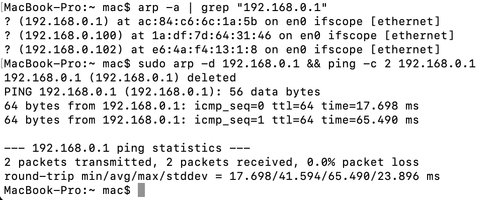
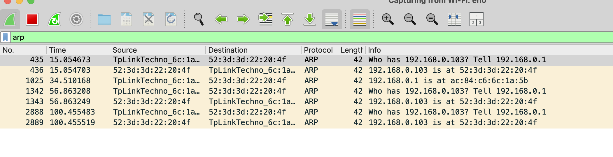
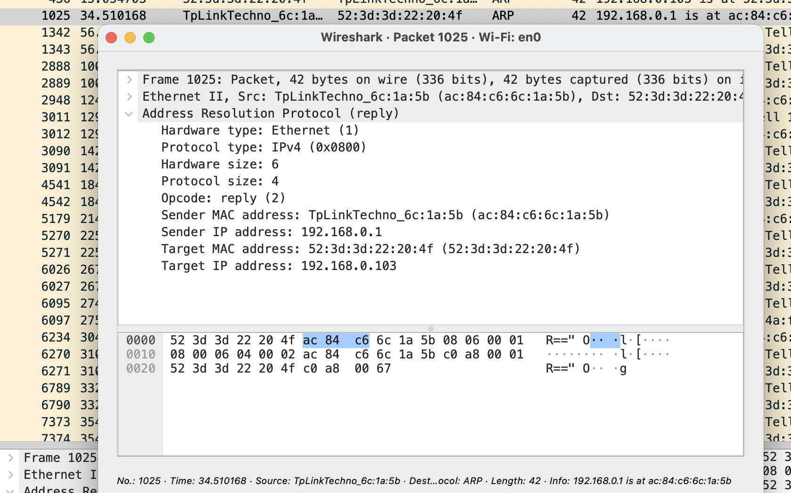
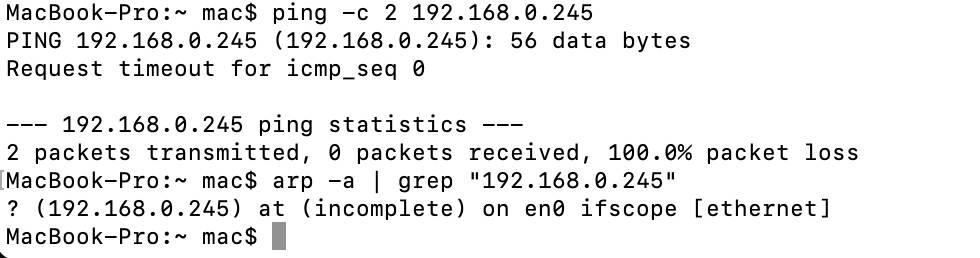

```markdown
# Лабораторна робота №2. Дослідження засобів канального рівня моделі OSI. Протокол ARP

* **Дисципліна:** Тестування та контроль якості (QA) вбудованих систем 
* **Студентка:** Катерина Терещенко
* **Варіант:** 0 (Визначення MAC-адреси за відомою IP-адресою: $27 \pmod 3 = 0$)
* **Мережне середовище:** macOS Host, Wi-Fi інтерфейс `en0`
  * Локальний хост (Client): `192.168.0.103` (MAC: `52:3d:3d:22:20:4f`)
  * Шлюз / Роутер (Gateway): `192.168.0.1` (MAC: `ac:84:c6:6c:1a:5b`, TP-Link)

---

## 1. Мета роботи
Дослідити принципи функціонування засобів канального рівня моделі OSI на прикладі протоколу ARP (Address Resolution Protocol), опанувати утиліти перехоплення та фільтрації мережного трафіка за допомогою аналізатора Wireshark, а також скласти комплект QA тестової документації (Test Cases) для верифікації мережного протоколу.

---

## 2. Теоретичні відомості

### Структура кадру Ethernet II та пакета ARP
| Рівень OSI | Поле | Розмір (байти) | Значення у Frame 1025 | Опис |
| :--- | :--- | :---: | :--- | :--- |
| **Ethernet II** | Destination MAC | 6 | `52:3d:3d:22:20:4f` | Фізична адреса хоста-отримувача |
| | Source MAC | 6 | `ac:84:c6:6c:1a:5b` | Фізична адреса відправника (TP-Link) |
| | EtherType | 2 | `0x0806` | Ідентифікатор протоколу ARP |
| **ARP Payload** | Hardware type | 2 | `Ethernet (1)` | Тип апаратного протоколу |
| | Protocol type | 2 | `IPv4 (0x0800)` | Тип мережного протоколу |
| | Hardware size | 1 | `6` | Довжина фізичної адреси |
| | Protocol size | 1 | `4` | Довжина логічної IP-адреси |
| | Opcode | 2 | `reply (2)` | Тип операції (ARP Відповідь) |
| | Sender MAC | 6 | `ac:84:c6:6c:1a:5b` | Фізична адреса шлюзу |
| | Sender IP | 4 | `192.168.0.1` | Логічна IP-адреса шлюзу |
| | Target MAC | 6 | `52:3d:3d:22:20:4f` | Фізична адреса запитуючого хоста |
| | Target IP | 4 | `192.168.0.103` | IP-адреса хоста |

---

## 3. Практичне виконання

1. **Очищення кешу та генерація трафіка:**
   ```bash
   sudo arp -d 192.168.0.1 && ping -c 2 192.168.0.1
   arp -a | grep "192.168.0.1"

```

2. **Негативний тест (звернення до вільної IP-адреси):**
```bash
ping -c 2 192.168.0.245
arp -a | grep "192.168.0.245"

```


---

## 4. Результати тестування (Скриншоти)

### 4.1. Очищення ARP-кешу, ICMP-запит та оновлення таблиці


### 4.2. Перехоплення потоку ARP у Wireshark


### 4.3. Детальний аналіз полів фрейму ARP Reply (Frame 1025)


### 4.4. Обробка звернення до неіснуючого хоста (100% loss, incomplete)


---

## 5. QA Тестова документація

### Test Case 1: Отримання MAC-адреси вузла за відомою IP-адресою (Варіант 0)

* **ID:** `TC-ARP-001`
* **Назва:** Успішне встановлення відповідності IP -> MAC за допомогою ARP Request / Reply
* **Пріоритет:** High | **Тип:** Functional / Positive
* **Preconditions:** Хост `192.168.0.103` у мережі, запис роутера видалено (`sudo arp -d 192.168.0.1`), Wireshark фільтрує `arp`.

| Крок | Дія | Очікуваний результат | Фактичний результат | Статус |
| --- | --- | --- | --- | --- |
| 1 | `sudo arp -d 192.168.0.1` | Видалення запису з кешу | Запис видалено (`deleted`) | **Pass** |
| 2 | `ping -c 2 192.168.0.1` | Ініціалізація ARP-запиту, 0% втрат | 2 packets transmitted, 0.0% loss | **Pass** |
| 3 | Перевірка Wireshark | Фіксація Request та Reply | Отримано Reply: `192.168.0.1 is at ac:84:c6:6c:1a:5b` (Frame 1025) | **Pass** |
| 4 | `arp -a | grep 192.168.0.1` | Додавання динамічного запису в кеш | `? (192.168.0.1) at ac:84:c6:6c:1a:5b on en0` | **Pass** |

---

### Test Case 2 (Бонусний): Запит до неіснуючого хоста в локальному сегменті

* **ID:** `TC-ARP-002`
* **Назва:** Обробка відсутності ARP Reply при зверненні до вільного IP
* **Пріоритет:** Medium | **Тип:** Negative / Boundary
* **Preconditions:** Wireshark запущено з фільтром `arp`.

| Крок | Дія | Очікуваний результат | Фактичний результат | Статус |
| --- | --- | --- | --- | --- |
| 1 | `ping -c 2 192.168.0.245` | Відсутність відповіді, таймаут | `Request timeout`, `100.0% packet loss` | **Pass** |
| 2 | Перевірка Wireshark | Відправка Broadcast без отримання Reply | Фіксуються тільки запити `Who has 192.168.0.245?` | **Pass** |
| 3 | `arp -a | grep 192.168.0.245` | Запис відсутній або має статус `incomplete` | `? (192.168.0.245) at (incomplete) on en0` | **Pass** |

---

## 6. Висновок

Під час виконання лабораторної роботи було досліджено функціонування засобів канального рівня моделі OSI на прикладі протоколу ARP. За допомогою утиліти Wireshark детально проаналізовано структуру полів кадру Ethernet II та пакета ARP Reply, експериментально підтверджено оновлення таблиці сусідів в ОС macOS та поведінку мережного стека ОС при зверненні до неактивного хоста (статус `incomplete`). Складено та успішно верифіковано комплект тестової документації (Test Cases).

```

```
